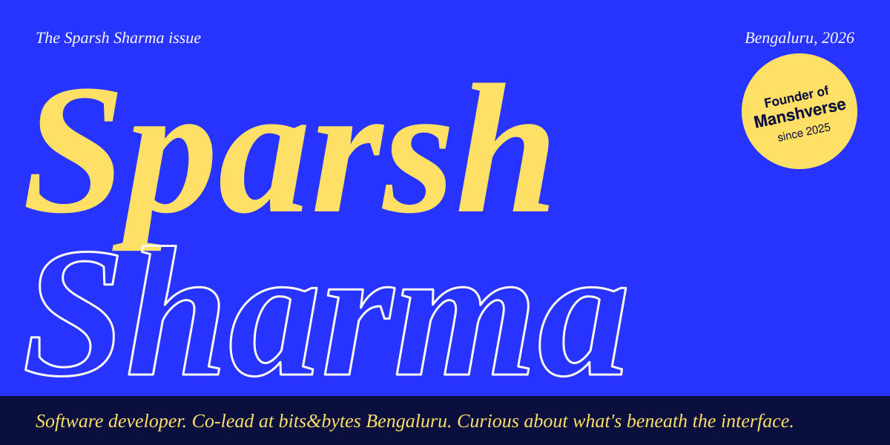

 

# I want to know what happens beneath the interface.

How information moves through a product. What the app does when the connection drops. How one small interface decision changes whether you trust it.

I'm **Sparsh Sharma**, a B.Tech Computer Science student at SAREC, Mirzapur, from Bengaluru. I make web and mobile software: interfaces, APIs, auth, data flows, AI integrations, and things that keep working offline.

> I like products whose behavior I can explain.

 

---

 

## Manshverse: one chat app that chooses its own model

I started Manshverse in march 2026 and built it alone. It's a chat app for **web and Android** where you pick an AI model, or talk to a character persona. Behind it sit Groq, Gemini and Mistral, with routing based on what you ask.

It ships with UPI subscriptions, an admin dashboard and an Android APK, so it's a real product with real plumbing, not a demo.

**Read the story:** [case study](https://sparshsharma.lol/case-manshverse.html) · **Use it:** [manshverse.site](https://manshverse.site) · **Code:** [web](https://github.com/sparshsharmadev/manshverse-web) and [Android](https://github.com/sparshsharmadev/manshverse-app)

*Built with React, React Native, Expo, Firebase, Groq and Gemini.*

 

---

 

## Also on the shelf

<table>
  <tr>
    <td width="30%" valign="top"><h3>Polaris</h3>Smart India Hackathon 2026</td>
    <td valign="top"><b>An expedition planner that works with no signal.</b> An offline-first prototype for supply operations at polar research stations. I led a team of six on interface, local-first data and planning. It's a prototype: station status and telemetry are simulated. React, Vite, IndexedDB, CRDT concepts. <a href="https://github.com/sparshsharmadev/polaris">Source</a></td>
  </tr>
  <tr>
    <td valign="top"><h3>LoreSync</h3>In early development</td>
    <td valign="top"><b>Your chat exports, explored in the browser.</b> Load a WhatsApp text export or a Discord JSON export and see activity, participants and milestones. Analysis runs locally. No sentiment scores, no relationship verdicts. TypeScript, React, IndexedDB, Supabase. <a href="https://github.com/sparshsharmadev/loresync">Source</a> and <a href="https://loresyncweb.vercel.app">preview</a> (use synthetic chats)</td>
  </tr>
  <tr>
    <td valign="top"><h3>Lexivoid</h3></td>
    <td valign="top"><b>A word for the feeling you can't name.</b> Describe a feeling or situation and the app asks Mistral for an English word to explore. JavaScript, Node.js, Mistral API, Vercel. <a href="https://lexivoid.vercel.app">Try it</a> or <a href="https://github.com/sparshsharmadev/Lexivoid">read the code</a></td>
  </tr>
  <tr>
    <td valign="top"><h3>MilkDream</h3></td>
    <td valign="top"><b>Save a moment. Open it later.</b> A digital time capsule for the things you want to come back to. Next.js, Firebase. <a href="https://milkdream.vercel.app">Try it</a> or <a href="https://github.com/sparshsharmadev/milkdream">read the code</a></td>
  </tr>
  <tr>
    <td valign="top"><h3>Conduit</h3></td>
    <td valign="top"><b>Real-time chat, from phone to database.</b> A React Native client, a Node and Express server, live updates over Socket.io, and Prisma underneath. My way of understanding the whole messaging path. <a href="https://github.com/sparshsharmadev/Conduit">Source</a></td>
  </tr>
</table>

 

## Built for other people

**[RASHMÉ](https://www.rashme.in)** is the official site for a hair-care brand, with the product story, an ingredient guide and care rituals. **[Durga Agency](https://durgaagency.vercel.app)** is an agency site with a Canvas-based interactive visual and animated motion.

 

## Community

Since early 2026 I've co-led **bits&bytes Bengaluru**, a developer community that runs meetups, hackathons and technical sessions. I built and maintain [its website](https://bangalore.gobitsnbytes.org).

 

## Writing

- [Learning How Transformers Work with PyTorch](https://sparshsharma.lol/blog/building-transformers-from-scratch): tokens, embeddings, self-attention and causal masking. A learning exercise, and the post says so.
- [Connecting AI models in Manshverse](https://sparshsharma.lol/blog/building-ai-routing-engine): how I chose between models, wired up three providers, and shipped the same chat to web and Android.

 

---

 

## The toolbox

**Interfaces:** HTML, CSS, JavaScript, TypeScript, React, React Native, Expo, Next.js

**Servers and data:** Node.js, Express, Firebase, PostgreSQL, MongoDB, Prisma, REST APIs

**AI work:** Groq, Gemini and Mistral APIs, plus PyTorch for independent study

**Shipping:** Git, GitHub, Vercel

## Say hello

[sparshsharmadev@gmail.com](mailto:sparshsharmadev@gmail.com) · [Portfolio](https://sparshsharma.lol) · [Resume](https://sparshsharma.lol/resume.html) · [LinkedIn](https://linkedin.com/in/sparshsharmadev) · [X](https://x.com/sparshsharmadev) · [dev.to](https://dev.to/sparshsharmadev) · [Medium](https://medium.com/@sparshsharmadev)

Last updated November 2026.
